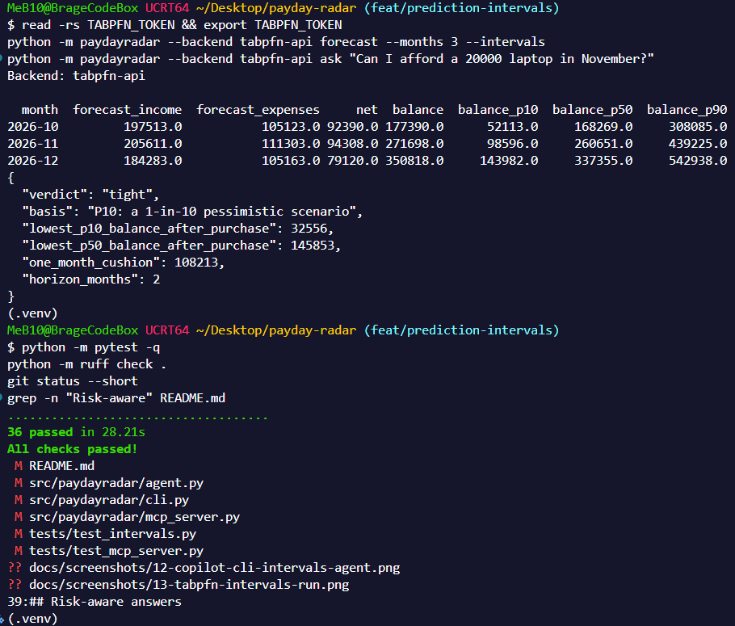
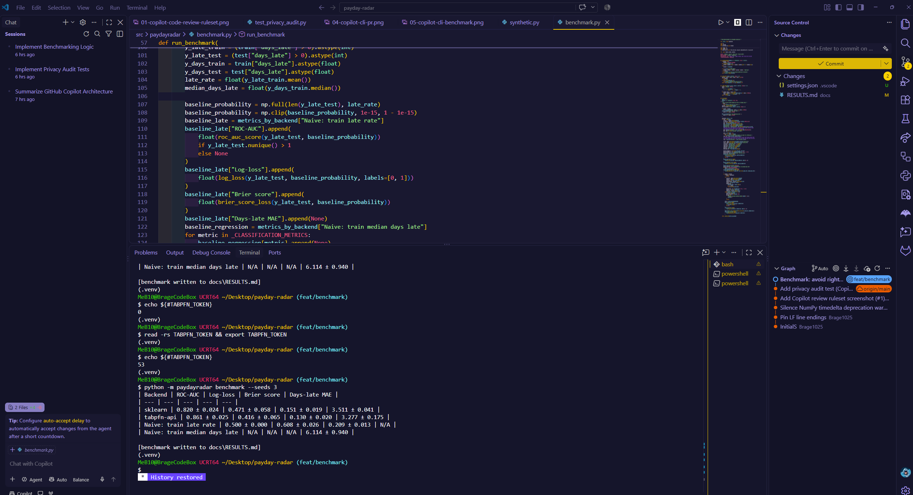
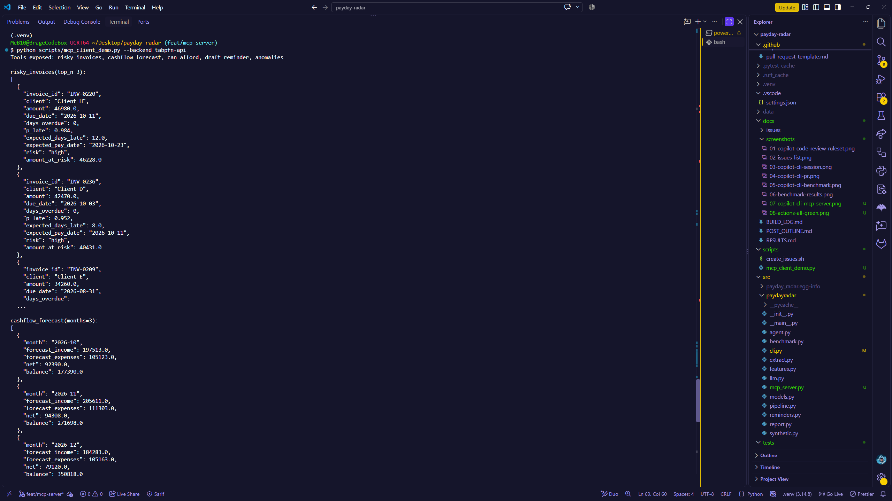

# Payday Radar

[](https://github.com/Brage1025/payday-radar/actions/workflows/ci.yml)

**See late payments coming before they hurt.** Payday Radar reads a freelancer's invoices and
expenses (CSV), predicts which open invoices will be paid late, forecasts the next 90 days of cash
with P10/P50/P90 scenarios, flags odd expenses and duplicate invoices, drafts the reminder emails,
and answers "can I afford X?". All prediction is done by **TabPFN-3.5**, and every capability is also
exposed to any AI agent through an **MCP server**.

Built for the Hacktoberfest Open-Source AI Challenge (Week 2: Side Hustle), competing for the
**Best Use of TabPFN** and **Best Use of GitHub Copilot**.

## Demo video

[](https://youtu.be/FQ7_4DeTln8)

All data in the video is synthetic. Note that TabPFN-3.5 is licensed for non-commercial use only.



## What it does

| Question                                                          | How                                                                                                               |
| ----------------------------------------------------------------- | ----------------------------------------------------------------------------------------------------------------- |
| Which open invoices will be paid late, and by how many days?      | TabPFN classifier + regressor on leak-free, numeric-only client-history features                                  |
| What will my cash look like in 90 days, and how bad could it get? | TabPFN regressor with quantile output, then a Monte Carlo over the quantiles gives balance P10/P50/P90            |
| Is this expense or invoice odd?                                   | TabPFN predicts the expected expense amount; large residuals are flagged. Duplicate invoices are caught by a rule |
| Can I afford a 20,000 laptop in November?                         | Agent tool that answers from the pessimistic **P10** balance, not the average                                     |
| Who do I chase, and what do I say?                                | Reminder drafts in English or Norwegian                                                                           |

Example (synthetic data, TabPFN-3.5 hosted API): the same question gets two different answers.

```text
Mean forecast:   "yes"   (157,390 left after the purchase)
P10 scenario:    "tight" (32,556 left, below the one-month cushion of 108,213)
```

## Status: what is verified and what is not

| Piece                                             | Status                                                                        |
| ------------------------------------------------- | ----------------------------------------------------------------------------- |
| scikit-learn backend (fallback)                   | Tested in CI (Python 3.10 and 3.12), 36 tests                                 |
| TabPFN-3.5 hosted API (`tabpfn-api`)              | Run end to end: demo, benchmark, intervals, MCP server                        |
| MCP server over stdio                             | Tested with a separate client (`scripts/mcp_client_demo.py`) on both backends |
| TabPFN local weights (`tabpfn-local`)             | Implemented, **not yet run**                                                  |
| Local vision model extraction (Ollama)            | Implemented; parsers unit-tested; **not yet run against a real model**        |
| Real-user data                                    | **None yet** (see Licensing)                                                  |
| Copilot coding agent, automatic Copilot PR review | **Not used** (Free plan)                                                      |

## Quickstart (no token, no GPU, no Ollama)

```bash
pip install -e ".[dev]"
python -m paydayradar --backend sklearn demo
python -m pytest -q
```

Commands (all take `--backend sklearn|tabpfn-api|tabpfn-local|auto`):

| Command                                               | Does                                                                      |
| ----------------------------------------------------- | ------------------------------------------------------------------------- |
| `generate`                                            | Write synthetic invoices and expenses to `data/synthetic/`                |
| `score`                                               | Late-payment risk for every open invoice                                  |
| `forecast --months 3 [--intervals]`                   | Cash-flow forecast, optionally with P10/P50/P90 balance                   |
| `anomalies`                                           | Unusual expenses and duplicate invoices                                   |
| `ask "Can I afford a 20000 laptop in November?"`      | Agent answer (uses Ollama tool calling if running, else a keyword router) |
| `demo [--out report.md]`                              | Everything above in one run                                               |
| `benchmark --seeds 3 [--backends sklearn,tabpfn-api]` | TabPFN vs scikit-learn vs naive baselines                                 |
| `mcp [--redact]`                                      | Run the MCP server over stdio                                             |

## Use TabPFN-3.5

```bash
# Hosted API: sign up at https://platform.priorlabs.ai and accept the license
pip install -e ".[tabpfn-api]"
export TABPFN_TOKEN=...          # never commit this
python -m paydayradar --backend tabpfn-api demo

# Local weights (gated download, needs the license accepted on your Prior Labs account)
pip install -e ".[tabpfn-local]"
python -m paydayradar --backend tabpfn-local demo
```

`--backend auto` picks the hosted API if `TABPFN_TOKEN` is set, else local if installed, else the
scikit-learn fallback. All model construction goes through `src/paydayradar/models.py`.

## Risk-aware answers

A TabPFN regressor predicts a full distribution, not one number. Payday Radar asks for quantiles
(`output_type="quantiles"`) at 5/10/25/50/75/90/95%, samples monthly income and expenses from them,
and builds balance paths, so a forecast comes with P10 (a bad 1-in-10 scenario), P50 and P90.
`can_afford` answers from the P10 path.

Assumptions and limits, stated plainly:

- Months and the income/expense series are treated as independent in the simulation.
- Sampling is truncated at the 5th and 95th percentiles, so extreme tails are not modelled.
- The verdict uses the lowest of the monthly P10 balances, which is slightly optimistic: the chance of
  dipping below that level in at least one month is a little above 10%.
- The scikit-learn fallback approximates quantiles from the spread of the random forest's trees.
- Nothing here has been validated on real data.

## Benchmark (synthetic data, 3 seeds, time-ordered split)

| Backend                       | ROC-AUC ↑         | Log-loss ↓        | Brier ↓           | Days-late MAE ↓   |
| ----------------------------- | ----------------- | ----------------- | ----------------- | ----------------- |
| scikit-learn random forest    | 0.820 ± 0.024     | 0.471 ± 0.058     | 0.151 ± 0.019     | 3.511 ± 0.041     |
| **TabPFN-3.5 (hosted API)**   | **0.861 ± 0.025** | **0.416 ± 0.065** | **0.130 ± 0.020** | **3.277 ± 0.175** |
| Naive: train late rate        | 0.500             | 0.608             | 0.209             | n/a               |
| Naive: train median days late | n/a               | n/a               | n/a               | 6.114             |



Read it carefully: the probabilities (log-loss, Brier) improve more clearly than the accuracy; the
days-late MAE gain is within one standard deviation; there are only 3 seeds and about 60 test
invoices each; the data is synthetic; the baseline forest is untuned. The split drops invoices too
recent to have resolved and training labels that were unknown at the cutoff (a first version without
this was too optimistic by about 0.03 ROC-AUC). Reproduce with
`python -m paydayradar benchmark --seeds 3`. Output goes to `docs/RESULTS.md`.

## MCP server: TabPFN inside an agent

```bash
pip install -e ".[mcp]"
python -m paydayradar --backend sklearn mcp --redact
```

Tools: `risky_invoices`, `cashflow_forecast` (optional `intervals`), `can_afford`, `draft_reminder`,
`anomalies`. Each returns one JSON text block; sizes are clamped because every forecast month is a
model call.

Client config (use the absolute path to your data):

```json
{
  "mcpServers": {
    "payday-radar": {
      "command": "python",
      "args": [
        "-m",
        "paydayradar",
        "--data",
        "/abs/path/to/data/synthetic",
        "--backend",
        "tabpfn-api",
        "mcp",
        "--redact"
      ],
      "env": { "TABPFN_TOKEN": "your-key-here" }
    }
  }
}
```

MCP clients start servers with a minimal environment, so pass `TABPFN_TOKEN` explicitly and keep
that config out of version control.

No desktop client needed to test it:

```bash
python scripts/mcp_client_demo.py                     # launches the server, calls the tools, leak-checks
python scripts/mcp_client_demo.py --backend tabpfn-api
python scripts/mcp_client_demo.py --no-redact         # the leak check should fail
```



## Privacy model

- Prediction features are numbers only. `models.ensure_numeric` raises `PrivacyError` otherwise, and
  `tests/test_privacy_audit.py` audits every frame the moment it reaches a model's fit or predict
  (including quantile calls). This matters because TabPFN-3.5 accepts text columns, so a string leak
  would not crash.
- `--redact` replaces client and vendor names with aliases in MCP tool output. **It protects names only.**
  Amounts, dates and invoice IDs still reach the client, so use a local model if that matters.
  A redacted reminder says "Hi Client H", so you need a local alias lookup before sending one.
- With the hosted API, the numeric feature tables are sent to Prior Labs' servers. With
  `tabpfn-local`, nothing leaves the machine after the one-time weight download.

## Licensing: read before using real data or charging money

The TabPFN-3.5 weights and API key come under a **non-commercial** license. As summarised on the model
card, the license bars commercial or production use of the model and its outputs, including revenue-generating
products, client deliverables and internal commercial decision-making. Read the full text:
https://huggingface.co/Prior-Labs/tabpfn_3_5

Consequences for this repo:

- It is a research and evaluation prototype with a business model, not a product you can sell on TabPFN-3.5 today.
- Do not run it with TabPFN-3.5 on your real business finances. Use `--backend sklearn` for that,
  or get a commercial license from Prior Labs.
- A commercial-safe path (not yet implemented or tested here): earlier TabPFN-2 weights are released under
  a more permissive license with an attribution requirement; check the terms before relying on them.

This repo's code is MIT.

## Built with GitHub Copilot (Free plan)

The coding agent and automatic Copilot PR review need a paid plan, so I did not use them. I used:

- **Copilot CLI** to draft four features on branches (privacy audit test, benchmark, MCP server,
  prediction intervals), steered by `.github/copilot-instructions.md`.
- **GitHub Actions**: CI (`ci.yml`, Python 3.10 and 3.12), a weekly report (`weekly-radar.yml`) and
  an environment file for Copilot (`copilot-setup-steps.yml`).
- Every change went through a PR (a branch ruleset blocks direct pushes to `main`).

The first scaffold and the reviews were done with Claude. `docs/BUILD_LOG.md` records who built what,
what review found wrong in each Copilot draft, and screenshots of each step.

## Project layout

```text
src/paydayradar/   synthetic.py features.py models.py pipeline.py agent.py mcp_server.py
                   extract.py llm.py reminders.py benchmark.py report.py cli.py
scripts/           mcp_client_demo.py  create_issues.sh
tests/             36 tests, all offline (scikit-learn backend, mocked LLM)
docs/              BUILD_LOG.md  RESULTS.md  issues/  screenshots/
.github/           copilot-instructions.md  workflows/
```

## Roadmap

Open issues in `docs/issues/`: Streamlit dashboard, PDF and scan ingest, Norwegian/EU invoice layouts,
extraction evaluation, forecast reconciliation with open invoices, receipt categorisation, reminder tones,
offline-mode docs. Ideas not yet filed: interval coverage in the benchmark, a commercial-safe backend,
a local alias lookup for redacted reminders.

---

<div align="center">

_"To &lt;div&gt; or not to &lt;div&gt;, that is the question."_
— [Brage1025](https://github.com/Brage1025)

</div>
