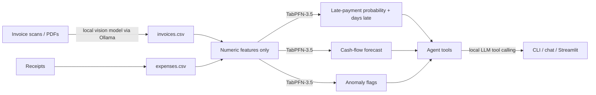

# 📡 Payday Radar

**See late payments coming before they hurt.** A local-first cash-flow radar for freelancers
and tiny agencies: it reads your invoices, predicts which ones will be paid late, forecasts the
next 90 days of cash, flags odd expenses and duplicate invoices, drafts the reminder emails, and
answers "can I afford X?"

Built for the Hacktoberfest Open-Source AI Challenge (Week 2: Side Hustle).

## Why open matters here

| Need                                                        | Closed SaaS                | Payday Radar                                                                                                                                  |
| ----------------------------------------------------------- | -------------------------- | --------------------------------------------------------------------------------------------------------------------------------------------- |
| Client names and invoice text stay private                  | Uploaded to a vendor       | Extraction runs in a local open-weight model (Ollama). Only numeric features can reach TabPFN, enforced in code (`ensure_numeric`) and tested |
| Per-document cost                                           | Per-seat or per-page fees  | Zero marginal cost locally, so a small flat price still has margin                                                                            |
| Local invoice formats (KID, MVA, `31.10.2026`, `12 345,67`) | Generic OCR guesses        | Swap the vision model, tune the prompt, fine-tune later                                                                                       |
| Lock-in                                                     | Their model, their pricing | Every model sits behind a swappable backend                                                                                                   |

## How it works



TabPFN does three jobs: **classification** (will this invoice be late?), **regression**
(how many days late; next month's income and expenses), and **anomaly spotting**
(predict the expected expense amount, flag big residuals). They are wrapped as tools in a small
agent so you can ask questions in plain language.

## Quickstart (no token, no GPU, no Ollama)

```bash
pip install -e ".[dev]"
python -m paydayradar --backend sklearn demo
```

This generates synthetic freelancer data and prints risky invoices, a forecast, a draft
reminder and an answer to "Can I afford a 20000 laptop in November?". Commands: `generate`,
`score`, `forecast`, `anomalies`, `ask "..."`, `demo --out report.md`.

## Use TabPFN-3.5

```bash
# Hosted API (free non-commercial license; key from https://platform.priorlabs.ai)
pip install -e ".[tabpfn-api]"
export TABPFN_TOKEN=...
python -m paydayradar --backend tabpfn-api demo

# Local weights, can run fully offline after the first download
pip install -e ".[tabpfn-local]"
python -m paydayradar --backend tabpfn-local demo
```

`--backend auto` (default) picks hosted if `TABPFN_TOKEN` is set, else local if installed,
else the scikit-learn fallback. The fallback exists so tests and CI run anywhere.

> ⚠️ The sandbox this scaffold was written in could not run TabPFN itself, so the TabPFN code
> paths follow Prior Labs' docs (`create_default_for_version("v3.5")`) but are untested.
> Run the demo with each backend once and fix anything that differs from your installed version.

## Results (synthetic data, 3 seeds, time-ordered split)

| Backend                    | ROC-AUC   | Log-loss  | Brier     | Days-late MAE |
| -------------------------- | --------- | --------- | --------- | ------------- |
| scikit-learn random forest | 0.820     | 0.471     | 0.151     | 3.511         |
| **TabPFN-3.5 (API)**       | **0.861** | **0.416** | **0.130** | **3.277**     |
| Naive baselines            | 0.500     | 0.608     | 0.209     | 6.114         |

TabPFN's probabilities are noticeably better calibrated, which matters because the
radar ranks invoices by `amount × P(late)`. Caveats: synthetic data, 3 seeds, small test sets,
untuned baseline. Reproduce with `python -m paydayradar benchmark --seeds 3`.

## Local open-weight models (Ollama)

```bash
ollama pull qwen2.5vl:7b   # reads invoice images
ollama pull qwen2.5:7b     # agent chat + reminder polish (supports tool calling)
```

Override with `PAYDAY_VISION_MODEL` / `PAYDAY_TEXT_MODEL`. With Ollama stopped, the agent falls
back to a keyword router and reminders use plain templates, so the demo always works.

## Use as an MCP server

Install the optional MCP SDK and start Payday Radar over stdio:

```bash
pip install -e ".[mcp]"
python -m paydayradar --data data/synthetic --backend sklearn mcp --redact
```

Claude Desktop configuration (replace the paths with your local checkout and data directory):

```json
{
  "mcpServers": {
    "payday-radar": {
      "command": "python",
      "args": [
        "-m",
        "paydayradar",
        "--data",
        "C:\\Users\\MeB10\\Desktop\\payday-radar\\data\\synthetic",
        "--backend",
        "tabpfn-api",
        "mcp",
        "--redact"
      ],
      "env": { "TABPFN_TOKEN": "your-key-here" }
    }
  }
}
```

Generic MCP client configuration:

```json
{
  "command": "python",
  "args": [
    "-m",
    "paydayradar",
    "--data",
    "data/synthetic",
    "--backend",
    "sklearn",
    "mcp",
    "--redact"
  ]
}
```

Tool outputs contain client and vendor names unless `--redact` is used. Connecting a cloud LLM
client can therefore send those names to that provider; use `--redact` when connecting one.

MCP clients start servers with a minimal environment. To use TabPFN, pass the key in the
client's config (for example `"env": { "TABPFN_TOKEN": "your-key" }`) and keep that config
file out of version control.

## Privacy model

- Client names and any free text are used only for local look-ups.
- `features.py` outputs numbers only; `models.ensure_numeric` raises `PrivacyError` otherwise.
- With `tabpfn-local` nothing leaves the machine at all.

## Licensing (read before charging money)

The TabPFN API key is issued under a **free non-commercial license**. Treat this repo as a
prototype with a business model. Before selling it, check Prior Labs' current terms and get a
commercial license, or ship the paid tier with a different approach for the prediction step.
This code is MIT.

## Built with GitHub Copilot
Built on the Copilot **Free** plan, so I used **Copilot CLI** and **GitHub Actions**; the paid
coding agent and automatic PR review were not available.
- `.github/copilot-instructions.md` steers Copilot CLI (privacy rules, offline tests).
- Features were drafted with Copilot CLI on feature branches, then reviewed and verified by hand:
  the privacy audit test, the TabPFN benchmark and the MCP server.
- Actions: CI (`ci.yml`), agent setup (`copilot-setup-steps.yml`) and a weekly report (`weekly-radar.yml`).
- Full attribution, including what Copilot got wrong: `docs/BUILD_LOG.md`.

## Roadmap

See `docs/issues/`: dashboard, PDF ingest, Norwegian layouts, extraction eval, MCP server,
forecast reconciliation, prediction intervals, receipts, reminder tones, benchmark, offline mode, privacy audit.

## First-user checklist (bonus points)

1. Find one freelancer with real late-paying clients. 2. Have them run it on _their_ CSV locally.
2. Ask: would you pay, how much, what's missing? 4. Log answers in your post.
